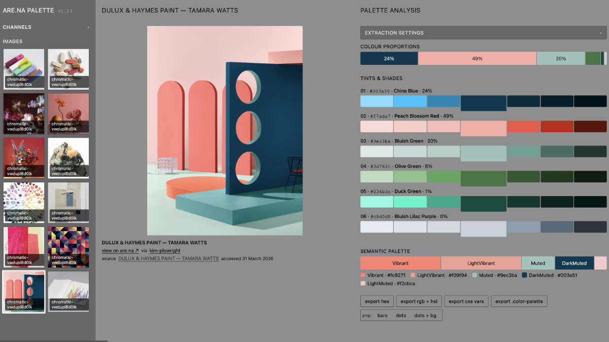

# Are.na Palette



**[Try it](https://mildlydiverting.github.io/are.na-toolkit/arena-palette.html)**

Extract colour palettes from images in your are.na channels. Click an image to pull its dominant colours, name them, and export in whatever format your tools need.

**What it does:**
- Fetches image blocks from one or more are.na channels
- Extracts dominant colours using [Color Thief](https://lokeshdhakar.com/projects/color-thief/)
- Names each colour via the [color.pizza API](https://github.com/meodai/color-name-api)
- Generates tints and shades for each colour
- Builds a semantic palette: dominant, accent, background, highlight, contrast
- Proportion bar showing the visual weight of each colour
- Dark / mid / light theme toggle for previewing palettes in context

**Export formats:** hex list · RGB · HSL · CSS custom properties · SCP JSON · Adobe Swatch Exchange (.ase) · GIMP palette (.gpl) · Procreate palette (.palette) · PNG swatch sheet

## Building

The source is in `src/`: `index.html` (with `@include` markers), the JavaScript modules, `style.css` and `third_party/` (Color Thief, inlined). It uses the same Node build as the newer tools.

```bash
node arena-palette/build.js --docs   # src/ → dist/arena-palette.html, and copy to docs/ for GitHub Pages
node arena-palette/build.js --watch  # rebuild on save
```

## More

- [`CONTEXT.md`](CONTEXT.md) — how the tool is put together
- [`HANDOFF-ase-gpl-procreate.md`](HANDOFF-ase-gpl-procreate.md) — the planned ASE, GPL and Procreate exports
